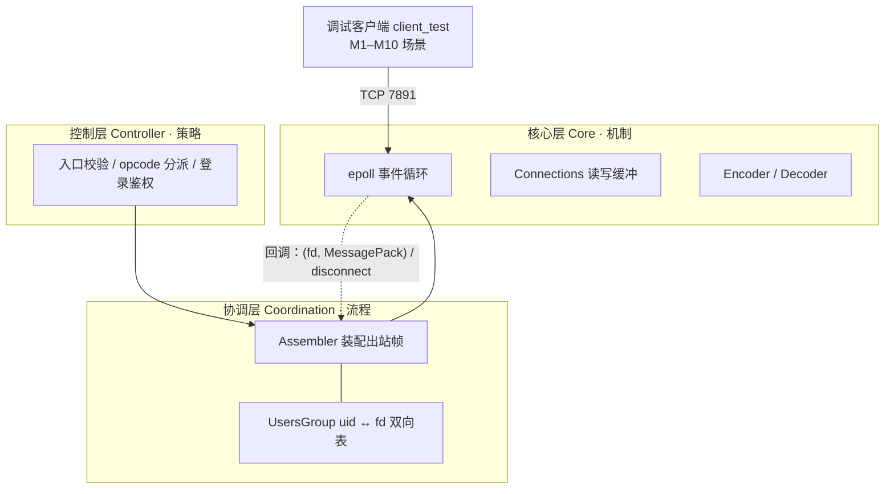

# com_lite

> 基于 C++20 + epoll 的轻量级即时通信服务端，重点在应用层分帧、非阻塞 I/O、多设备消息路由与分层边界。

**项目状态：搁置（Paused）**

最后提交 `6ba28f6`（2026-08-14）。主体链路可构建、可运行，但目前暂停新功能开发。`ctest` 的 11 个目标中有 9 个通过；剩余 2 个是帧头魔数改为网络字节序后，黄金字节测试向量未同步导致，详见 [当前状态与已知问题](#当前状态与已知问题)。

---

## 项目背景

`com_lite` 是一个面向 Linux 的即时通信服务端个人项目。最初所有逻辑集中在单个 `main()` 中：socket 的创建、epoll 循环、连接缓冲、消息编解码、业务分发全部耦合在一起，任何一层变化都会牵动整个文件，也无法独立测试。

项目的目标不是做一个可直接上线的 IM 产品，而是把这条链路完整拆开并用工程手段验证：

```
fd + 事件  →  字节流  →  一帧一帧  →  Message  →  业务决策
(epoll)     (读写缓冲)   (分帧/编解码)  (消息契约)   (登录/路由/应答)
```

最终形成 **控制层（策略）→ 协调层（流程）→ 核心层（机制）** 的三层结构，并围绕 TCP 粘包/拆包、跨 fd 转发、连接生命周期、编码缓冲复用等底层问题建立可复现的测试与调试手段。项目刻意不引入网络框架，epoll、非阻塞 socket、应用层协议和内存/缓冲管理均由标准库与系统调用直接实现。

> 定位说明：这是一个系统编程与网络服务端练习项目，不是生产级 IM。当前认证仍是静态用户表，没有 TLS、持久化、限流和配置系统。

## 核心功能

| 能力 | 实现要点 |
|---|---|
| 应用层分帧 | 固定 10 字节帧头：`magic(4) + body_len(4) + opcode(1) + status(1)`，帧体为 JSON；长度与魔数按网络字节序处理 |
| 编解码 | `Encoder` / `Decoder` 保持无状态；区分“暂时不完整”和“协议错误”；帧体上限 `65530` 字节；未知 opcode / status 直接拒绝 |
| 非阻塞 I/O | 单线程 epoll（LT）+ 非阻塞 `accept` / `read` / `send`；读缓冲软上限 64 KiB；写缓冲高水位 1 MiB |
| 登录与会话 | 新增 `Opcode::login`，登录帧复用 `Message` 结构；成功后将 `fd` 绑定到 `uid`；未登录连接发送非登录帧会被拒绝 |
| 消息路由 | `uid ↔ fd` 双向映射；一个 `uid` 可绑定多个 `fd`；`request` 向目标用户所有在线设备 fan-out |
| 背压处理 | `send()` 遇 `EAGAIN` 时保留写缓冲，并按需给目标 fd 挂 `EPOLLOUT`；排空后自动摘除，避免 LT 忙轮询 |
| 连接生命周期 | 登录时绑定、断开时解绑；延迟关闭队列保证同一轮 epoll 事件内不提前销毁连接；关闭操作幂等 |
| 安全模块（实验） | 基于 OpenSSL 3 `EVP_KDF` 的 PBKDF2-SHA512、`RAND_bytes` 盐生成、固定耗时执行器；尚未接入登录链路 |
| 测试与调试 | 11 个 CTest 目标、412 条 `CHECK` 断言；`client_test` 提供 M1–M10 手工端到端场景（回显、粘包/拆包、协议错误、双进程 fan-out、背压） |

## 技术栈

| 类别 | 选型 | 用途 |
|---|---|---|
| 语言 | C++20 | `std::byte`、`enum class`、结构化绑定、`std::function` 回调 |
| 构建 | CMake ≥ 3.14 | 目标级依赖、头文件搜索根统一、CTest 接入、ASan/UBSan 开关 |
| 网络 | Linux epoll / 非阻塞 TCP | 单线程事件循环、连接读写与背压 |
| 序列化 | nlohmann/json（单头文件） | `Message` 与 JSON 帧体互转 |
| 密码学 | OpenSSL 3 EVP API | PBKDF2-SHA512 KDF、随机盐、错误栈输出 |
| 测试 | CTest | 黄金字节、往返、路由、安全、头文件自足性 |
| 工具链 | GCC / Clang、ASan + UBSan | 警告闸门 `-Wall -Wextra -Wswitch-enum`；可选消毒器构建 |
| 平台 | Linux（epoll-only） | 未对 Windows / macOS 做构建验证 |

## 架构设计



| 层 | 职责 | 关键约束 |
|---|---|---|
| 控制层 `Controller` | 入口校验、按 opcode 分派、登录鉴权 | 只做语义决策，不直接操作 socket |
| 协调层 `Coordination` | 拼装出站帧、维护用户组、决定投递目标 | `UsersGroup` 是 `uid ↔ fd` 表的唯一持有者；路由决策在此层完成 |
| 核心层 `Core` | 编解码、读写 socket、驱动 epoll | 只面对具体 `fd`，不认识 `uid`，不读取用户组表 |

依赖方向始终自上而下；核心层通过回调把“解出一条消息”和“某个 fd 断开”上报给上层。出站队列元素是 `(MessagePack, 目标 fd)`，所以同一条入站消息可以产生多条出站帧，且各自目标不同。

### 帧格式

```text
偏移    0        4        8      9      10
       +--------+--------+------+------+-------------------+
       | magic  | length | op   | st   | JSON body         |
       | 4B     | 4B BE  | 1B   | 1B   | body_len bytes    |
       +--------+--------+------+------+-------------------+
```

- `magic = 0xFADEBEAD`，用于快速拒绝非本协议流量。
- `body_len` 是帧体字节数，不含 10 字节头；上限 `65530`，超限返回 `frame_too_long`。
- `opcode` 取 `ack` / `request` / `response` / `login`；`status` 取 `ok` / `fail`。线上字节先校验为已知枚举，再 `static_cast`。
- 解码器不把收到的字节直接 `reinterpret_cast` 成结构体，而是逐字段按偏移解析，规避字节序、对齐、padding 与 strict-aliasing 问题。

## 难点与解决方案

| # | 难点 | 解决方案 | 验证/结果 |
|---|---|---|---|
| 1 | TCP 是字节流，存在粘包、拆包和半帧 | 帧头显式声明 `body_len`；`Decoder` 在帧头/帧体未齐时返回 `incomplete`，与真正的协议错误分开；核心层 drain 循环持续解码到 `incomplete`，成功时按 `wire_size + body_len` 精确 `erase` 已消费字节 | `client_test` 的 M2/M3（一次发送两帧）、M4（半帧→停顿→补齐）覆盖；读缓冲残留有上界，不会因半帧无界增长 |
| 2 | 跨 fd 转发时，目标连接可能写阻塞 | `Connections` 维护 `write_buf_` + `write_pos_`；`send()` 遇 `EAGAIN` 返回 `would_block`（背压而非失败）；对目标 fd 跨连接挂 `EPOLLOUT`，排空后按 `want_write()` 重算掩码自动摘除；写缓冲超过 1 MiB 才判 `error` | 双进程 M8/M9/M10 场景验证慢消费与 12 MB 突发；避免“目标数据静默无限期滞留”和 `EPOLLOUT` 常驻导致的 CPU 空转 |
| 3 | 连接已判死但仍能被查到，写入永远上不了线 | `close_client()` 只做 `EPOLL_CTL_DEL` 并把 fd 放入 `pending_close_`，真正的 `conns_.erase` 推迟到本轮事件处理结束；跨 fd 写入前同时排除 `pending_close_` 中的目标；`close_client()` 幂等 | 解决同一轮 epoll 事件中连接被提前销毁、以及重复关闭触发两次解绑的问题 |
| 4 | 失败归因错误会杀掉无辜的发送方 | 出站循环区分三类失败：目标已死/待关闭、编码失败、写目标失败。前两者只丢当前条目；写目标失败关闭**目标**连接，发送方不受影响；自发自收单独回落到唯一入站杀点 | M9 停读变体触发写缓冲高水位，日志显示“关闭目标、发送方不受牵连” |
| 5 | fd 被操作系统复用后可能把消息发给错误用户 | uid 绑定发生在登录时而非 accept 时；断开即从 `UsersGroup` 解绑；`uid ↔ fd` 双向表维护精确逆映射；注册采用 `Registered / AlreadyBound / FdConflict` 三态，先分类后提交 | 双向 `invariants_ok()` 扫描 + `test_users_group` 覆盖重复登录、改绑冲突、多设备注销 |
| 6 | 编码缓冲反复分配，且失败时可能留下半帧 | 编码缓冲由调用方持有并跨消息、跨连接复用；`content_` 超限在序列化前零分配预检；帧体长度校验、`resize`、`body_len` 回写、写入有严格顺序；失败路径保证 `out_buf` 一字节未动、`body_len` 不回写 | 稳态下消除每条消息 64 KiB 的分配与清零；`test_encoder` 覆盖超长帧（E9）与错误后置条件 |
| 7 | OpenSSL EVP API 学习成本高，资源释放容易出错 | 按 `_new → Init → Update → Final → _free` 五步心智模型封装：`hash_details.h` 承接 EVP 细节，`security.h` 只暴露盐生成、PBKDF2 计算和固定耗时执行 | `test_security` 目前只做盐生成与 PBKDF2 调用的冒烟验证，尚未对拍标准测试向量；KDF 模块可编译、可调用，但尚未接入登录 |

## 项目成果

- 将单 `main()` 原型重构为可运行的三层服务端，完成“连接→登录→消息路由→应答”端到端链路。
- 代码规模约 **2.8k 行**服务端/协议源码、**2.1k 行**测试代码；Git 历史 **61 次提交**（2026-07-15 至 2026-08-14）。
- 建立 **11 个 CTest 目标、412 条断言**，覆盖编码黄金字节、解码黄金字节、往返一致性、类型值域、用户组、装配器、控制器、安全模块和头文件自足性。
- 编码器/解码器黄金向量互相独立：编码器测试不调用解码器，解码器测试不调用编码器，避免同一个字节序错误在两端互相掩盖；头文件测试为每个头文件生成独立翻译单元，防止隐式包含依赖。
- `client_test` 提供 M1–M10 场景：M1 单帧回显、M2/M3 粘包、M4 半帧、M5 非法消息、M6 未知 opcode、M7 登录、M8/M9/M10 双进程跨用户 fan-out 与背压。
- 已实际跑通：M1 回显、M7 登录成功/失败、M8+M10 跨 uid 三帧 fan-out；服务端在双进程场景下保持运行，发送方收到对应 `response`。

## 当前状态与已知问题

**项目目前处于搁置状态，暂停新功能开发。** 已有代码和文档保留为设计/实现记录。

### 已完成

- 三层架构、epoll 事件循环、非阻塞读写、连接对象化。
- 10 字节帧头、JSON 帧体、编解码器、错误分类（`incomplete` / `error` / `frame_too_long` / `would_block` 等）。
- 登录协议、静态用户表、uid↔fd 绑定、多设备 fan-out、断连解绑。
- 写缓冲背压、目标 fd 的 `EPOLLOUT` 武装、延迟关闭队列、失败归因。
- 测试体系与 M1–M10 调试客户端。
- PBKDF2-SHA512 KDF 模块、随机盐、固定耗时执行器（模块级）。

### 未完成 / 待收尾

1. **黄金向量未同步（当前 2 个测试失败）**：最新一次改动把魔数改为网络字节序（`htonl` / `ntohl`），`tests/test_encoder.cpp` 与 `tests/test_decoder.cpp` 仍按本机小端字节序断言。修复方式是同步测试向量与 `tests/test_support.h` 的 `make_frame`，服务端与客户端本身使用同一套编解码逻辑，端到端链路仍可运行。
2. **加密尚未接入登录**：登录仍是静态明文用户表；PBKDF2 模块没有参与凭证校验，也没有 TLS、失败次数限制或封禁策略。
3. **流式增量解析未实现**：当前仍把整帧字节攒在 `read_buf_` 中再解码；`TODO.md` 中的“分帧状态机”是性能优化项，不是错误路径正确性项。
4. **协议与健壮性遗留**：`response` opcode 当前静默丢弃；`ack` 帧体仍是占位；`server_seq_` 的去向未定；异常捕获仍包住整个 `run()`，单连接异常会影响事件循环；`UsersGroup` 仍是单线程设计。
5. **生产化缺失**：离线消息、持久化、配置化、结构化日志、限流、监控与压测均未落地。

更完整的开放事项、已划定的设计边界和每项决策的理由见 [`TODO.md`](TODO.md) 与 [`docs/logs/`](docs/logs/)。

## 构建与运行

### 依赖

- Linux（epoll）
- CMake ≥ 3.14
- 支持 C++20 的 GCC / Clang
- OpenSSL 开发包（`libssl-dev` / `openssl-devel`）

### 构建与测试

```bash
cmake -S . -B build -DCMAKE_BUILD_TYPE=Debug
cmake --build build -j

ctest --test-dir build --output-on-failure
# 当前预期：9/11 通过；Encoder / Decoder 的黄金向量待同步
```

启用 ASan + UBSan：

```bash
cmake -S . -B build-asan -DCOM_LITE_SANITIZE=ON
cmake --build build-asan -j
ctest --test-dir build-asan --output-on-failure
```

### 启动服务端

```bash
./build/src/server/server
```

默认监听 `7891`，演示用户表见 `src/server/main.cpp`：

- `alice / alice123`
- `bob / bob456`

### 单进程调试场景

```bash
# 单帧回显
./build/src/client/client_test m1

# 登录成功
./build/src/client/client_test m7 alice alice123

# 登录失败（预期退出码 1）
./build/src/client/client_test m7 alice wrong
```

### 双进程 fan-out 场景

先启动服务端，再开两个终端：

```bash
# 终端 A：alice 作为接收方，持续读取 10 秒
./build/src/client/client_test m8 alice alice123 10

# 终端 B：bob 向 alice 发送 3 条 request
./build/src/client/client_test m10 bob bob456 alice 3 128 1
```

预期 alice 收到 3 条转发帧，bob 收到 3 条 `response`，双方退出码均为 0。

## 目录结构

```text
src/
  common/        协议契约与编解码
    message.h        Message 值对象与 JSON 映射
    frame_header.h   10 字节帧头与编译期 wire_size
    binary_code.h    Opcode / Status 与线上值域校验
    encoder.h        MessagePack → 字节
    decoder.h        字节 → MessagePack
    security.h       PBKDF2 / 盐 / 固定耗时执行器
  server/
    main.cpp         装配 Core / Controller / UsersGroup
    core/            epoll 事件循环、连接读写缓冲
    controller/      opcode 分派、登录鉴权、路由决策
    coordination/    Assembler、User、UsersGroup
  client/
    client_test.cpp  M1–M10 手工调试客户端
tests/              CTest 目标与黄金向量
docs/               架构、非阻塞 I/O 参考、开发日志
TODO.md             开放事项的唯一清单
```

## 简历写法

**com_lite — 轻量级即时通信服务端**（个人项目，C++20 / epoll / CMake，2026.07–2026.08）

- 将单 `main()` 原型重构为 Controller / Coordination / Core 三层，依赖单向向下；核心层只处理 `fd` 与字节，`uid ↔ fd` 路由集中在 `UsersGroup`，降低跨层状态泄漏。
- 设计 10 字节固定头 + JSON 帧体的应用层协议，处理 TCP 粘包/拆包、半帧、超长帧和未知枚举；用黄金字节、往返一致性和头文件自足性测试锁定线上格式。
- 基于单线程 epoll（LT）实现非阻塞 `accept` / `read` / `write`；为跨 fd fan-out 增加写缓冲、1 MiB 高水位和按需 `EPOLLOUT`，解决目标连接背压滞留；用延迟关闭队列规避 fd 复用串消息。
- 实现登录态绑定与 `uid → 多 fd` 路由，支持同账号多设备 fan-out；以双向映射不变式、三态注册和断连解绑保证用户组一致性。
- 搭建 11 个 CTest 目标、412 条断言与 ASan/UBSan 开关；使用 OpenSSL 3 `EVP_KDF` 完成 PBKDF2-SHA512 加盐 KDF 模块与固定耗时执行器（模块级，尚未接入登录链路）。

## 文档

- [`docs/architecture.md`](docs/architecture.md)：分层设计、层间纪律、帧格式、数据流与迁移路线
- [`docs/ref.md`](docs/ref.md)：非阻塞 socket / epoll / errno / `IoStatus` 契约参考
- [`TODO.md`](TODO.md)：开放事项、已划定的设计边界
- [`docs/logs/`](docs/logs/)：按日期记录的实现过程、缺陷分析与设计决策
